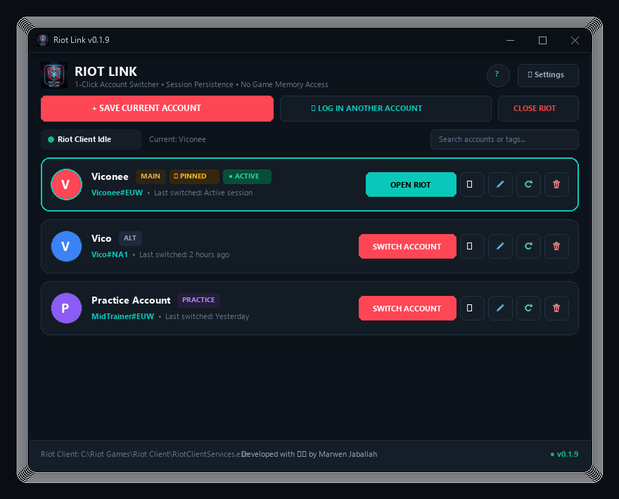

# ⚡ Riot Link

<div align="center">


**A lightweight, 1-click Riot Games account switcher for players with multiple legitimate accounts.**  
*Easily switch between regional servers, off-role practice accounts, or casual profiles without typing passwords.*

<br/>

[-00d2d3?style=for-the-badge&logo=windows&logoColor=black)](https://github.com/marwenjaballah/riot-link/releases/latest/download/RiotLink.exe)
[](https://github.com/marwenjaballah/riot-link/releases)

<br/><br/>



</div>

---

## 🎯 Why Riot Link?

If you play Riot games across multiple accounts—such as maintaining separate accounts on different regional servers (e.g. EUW and NA), practicing off-roles in League of Legends, playing casual TFT, or sharing a gaming PC in a household—manually typing usernames, passwords, and authenticating every time is tedious.

**Riot Link provides a clean, 1-click convenience launcher:**
* Saves authorized local sessions on your machine.
* Lets you switch profiles in seconds.
* Never interacts with live games or game memory.

---

## ✨ Key Features

* **⚡ 1-Click Instant Switching**: Click `Switch Account` on any saved profile and the official Riot Client opens already authenticated.
* **🛡️ Ban-Proof Design**: Riot Link **never touches game memory, never injects code, never modifies game files, and never force-terminates live games**. All game binaries are launched and executed strictly through the official Riot Client.
* **⛔ In-Match Protection**: If a game is active (`League of Legends.exe`, `VALORANT.exe`), Riot Link strictly blocks switching to protect against abnormal match departures.
* **🔒 Zero Plaintext Passwords**: Your passwords are never asked for, transmitted, or saved. Only local session tokens managed by the official Riot Client are used.
* **📲 Session Persistence**: Leverages Riot Client's native "Stay signed in" device authorization on your PC for seamless profile switching.
* **🔄 Intelligent Logout Detection**: If a session expires or gets logged out in Riot Client, Riot Link detects it, marks the profile, and provides a 1-click re-link button.
* **🔄 Built-In In-App Updates**: Automatically checks GitHub Releases for new versions with 1-click background verification and silent in-place installation. Every build is verified against SHA256 checksums before applying.
* **📥 Minimize to System Tray**: Runs quietly in your Windows notification tray on close (`X`), with quick access to switch accounts or restore the window.
* **🎮 Profile Customization**: Organize accounts with tags (`Main`, `Alt`, `Ranked`, `Practice`, `Casual`) and custom accent colors.
* **📦 Portable Backup & Restore**: Export and restore your saved profiles as a portable `.zip` when migrating to a new PC or reinstalling Windows. *(Intended strictly for personal use on your own hardware).*
* **💻 Portable Standalone Executable**: Single `.exe` with zero installation required.

---

## 📥 Download & Install

### Option A: Standalone Executable (Recommended)

1. Download the latest executable directly:
   * **[Download RiotLink.exe (v0.2.0)](https://github.com/marwenjaballah/riot-link/releases/latest/download/RiotLink.exe)**
   * Or download the full ZIP archive: **[RiotLink-v0.2.0-windows-x64.zip](https://github.com/marwenjaballah/riot-link/releases/latest/download/RiotLink-v0.2.0-windows-x64.zip)**
2. Place `RiotLink.exe` in any folder of your choice (e.g. `C:\Games\RiotLink\` or Desktop).
3. Run `RiotLink.exe`! No installer needed.

> [!NOTE]
> **Windows SmartScreen Notice**: Because Riot Link is an open-source tool without an expensive commercial EV code signing certificate, Windows Defender SmartScreen may show an unrecognized app banner.
> - Click **"More info"**
> - Then click **"Run anyway"**
> 
> Riot Link is 100% open-source. Passwords are never collected, and session data never leaves your computer. You can review the complete source code directly in this repository.

### Option B: Run from Source

```powershell
# 1. Clone the repository
git clone https://github.com/marwenjaballah/riot-link.git
cd riot-link

# 2. Install dependencies
pip install -r requirements.txt

# 3. Launch
python main.py
# Or run with:
.\run.bat
```

---

## 📖 Quick Start Guide (1-Minute Setup)

### 1️⃣ Save Your First Account
1. Open your official **Riot Client**.
2. Enter your credentials, **make sure "Stay signed in" is checked**, and log in.
3. Open **Riot Link** and click **`+ SAVE CURRENT ACCOUNT`** at the top.
4. Give it a nickname (e.g. `Main EUW`), select a tag and accent color, and click **Save Profile**.

### 2️⃣ Add Additional Accounts
1. In Riot Link, click **`🔑 LOG IN ANOTHER ACCOUNT`** at the top.
   *(This safely exits Riot Client and presents a clean login screen without invalidating your saved profiles).*
2. Log into your **second account** in Riot Client, ensuring **"Stay signed in"** is checked.
3. Once logged in, click **`+ SAVE CURRENT ACCOUNT`** in Riot Link!

### 3️⃣ Switch Anytime
* Click **`Switch Account`** on any profile card.
* The official Riot Client will launch already signed into that account.

---

## ❓ Frequently Asked Questions

#### How does Riot Link interact with Vanguard and anti-cheat?
Riot Link operates strictly as an external session manager. It does not read or write game memory, inject DLLs, alter game files, or hook into any game processes. It copies Riot Client's own configuration files while Riot Client is closed, then starts the official Riot Client via standard Windows Shell execution.

Because Riot Link never touches live games, it does not trigger Vanguard anti-cheat. However, Riot Link is an independent open-source project and is **not affiliated with or endorsed by Riot Games**.

#### How does session authorization work with Two-Factor Authentication (2FA)?
When you log into the official Riot Client with "Stay signed in" checked, Riot's authentication service authorizes your computer and creates a local session token. Riot Link preserves and restores these authorized local configuration files on your machine so you do not need to re-enter your credentials on each switch.

#### Can I click "Sign Out" inside the Riot Client?
⚠️ **Avoid clicking "Sign Out" inside the Riot Client window.** Clicking "Sign Out" instructs Riot's authentication servers to revoke and delete that session token. If you want to switch or add another account, use the **`Switch Account`** or **`🔑 LOG IN ANOTHER ACCOUNT`** buttons in Riot Link instead.

#### What if a profile shows `⚠️ LOGGED OUT`?
If an account session expires or was accidentally signed out:
1. Open Riot Client and log back into that account (with "Stay signed in" checked).
2. In Riot Link, click the highlighted **🔄 (Refresh)** button on that account card to re-link your session.

---

## 🔨 Building from Source

To compile the standalone Windows executable yourself:

```powershell
# Run the automated build script:
.\build.bat

# Or invoke PyInstaller directly:
pyinstaller --clean -y RiotLink.spec
```

The resulting standalone binary will be generated at `dist/RiotLink.exe`.

---

## 🤖 Continuous Integration & Releases

Automated builds and GitHub Releases are powered by [`.github/workflows/release.yml`](.github/workflows/release.yml):
- Automatically triggers on version tag pushes (`v*`).
- Generates Windows x64 binaries, creates archive packages, computes SHA256 checksums, and attaches assets to the GitHub Release.

---

## 👨‍💻 Author & Credits

Developed with ❤️ by **[Marwen Jaballah](https://github.com/marwenjaballah)**.

---

## 📄 License

Distributed under the [MIT License](LICENSE).

---

## ⚖️ Disclaimer

*Riot Link is not endorsed by or affiliated with Riot Games. Riot Games, VALORANT, League of Legends, and Teamfight Tactics are trademarks or registered trademarks of Riot Games, Inc. Use at your own discretion.*
